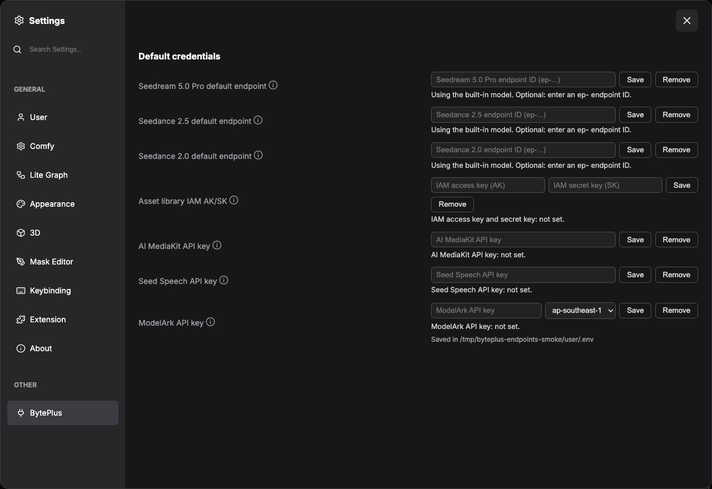
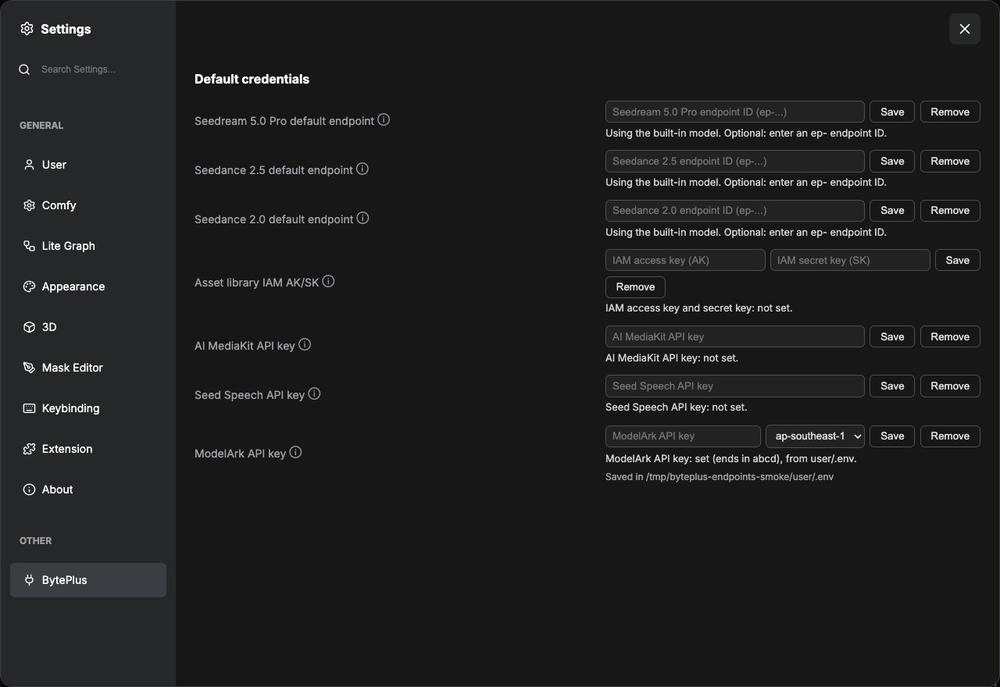
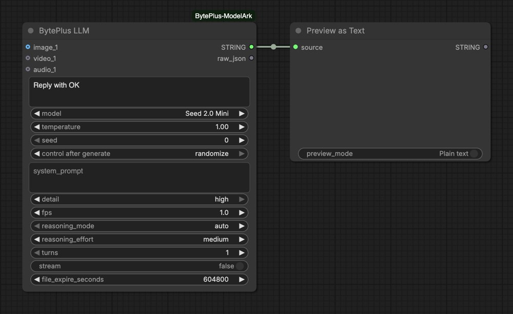

# ComfyUI BytePlus ModelArk, Speech, OmniHuman & MediaKit

Use BytePlus models in ComfyUI with **your own BytePlus API keys**: Seedream images, Seedance videos, Hyper3D and Hitem3D 3D models, Seed / DeepSeek / GLM language models, ModelArk and Seed Speech audio, OmniHuman avatar videos, and AI MediaKit video and image enhancement.

Calls go straight to BytePlus and are billed to your BytePlus account (contract pricing and resource packs apply). No Comfy credits are used.

> **Status: v0.15.0.** Requires ComfyUI 0.31.0 or later. Works in Classic Canvas and Nodes 2.0.

**New in v0.15.0:** Seedream 5.5 offers fixed **4K UHD** presets at `3840x2160` and `2160x3840`, plus custom sizes up to **8,294,400 pixels**. The presets send explicit dimensions using the same model ID. The 2K-adaptive default, other models and layer-separation limits stay unchanged. Restart ComfyUI and reload the browser, select `seedream 5.5`, then choose a `(4K)` size preset after updating to this version. Registry installation availability depends on the version's scan status.

**Previously in v0.14.0:** shared media sockets stay on the left when you change modes or models on Seed Audio 1.0/1.5, Seedream, Layer Separation, Seedance Reference and BytePlus LLM. Saved canvas connections migrate automatically on load; conflicting and unsupported media is rejected before billing. Provider request formats and model limits are unchanged. The docs include refreshed node screenshots and reference-mode views in both renderers.

**Direct API workflow migration:** rename moved media keys before submitting to ComfyUI's `/prompt`, for example `model.images.image_1` to `images.image_1` and `mode.video` to `video`. Prompt, URL, asset and other control keys stay unchanged. See the [media input migration guide](https://byteplus-sa.github.io/ComfyUI-BytePlus-ModelArk/get-started/update/#media-input-layout). Restart ComfyUI and reload the browser after updating. Registry availability depends on the version's scan status.

**Previously in v0.13.0:** the separate **BytePlus Seed Audio 1.5** node uses `dola-seed-audio-1-5-261128` and your **ModelArk API key** in Singapore. Generate audio, use up to six voice references or one image, create video-guided audio, translate video or separate stems, with optional video and subtitle outputs. Seed Audio 1.0 stays unchanged on the Seed Speech key. Pending cancellation is checked before submission; connected videos are size-checked after encoding, including trims and crops. There are no automatic paid submission retries. Registry installation availability depends on the version's scan status.

**Previously in v0.12.0:** render a reviewed 480p Seedance 2.5 draft at **1080p or 4K** with the Draft to Final node's `resolution` selector. The default remains 1080p. Endpoint-backed drafts now use the configured endpoint for final rendering, avoiding the canonical-model endpoint mismatch. Keep the same endpoint configuration between draft and final; no automatic paid retries were added.

Also included: the separate **Seed Speech TTS 3** node with 520 preset voices, direct voice-ID input, delivery instructions, optional subtitles and conversation sessions, using your existing Seed Speech key. Seedream 5.5 shared controls and fixed presets now match current ComfyUI core while preserving BytePlus limits and the Pro-first model selection. New 5.5 layer-separation nodes default to minimal-size layers; Pro and Flash remain full-canvas. Reload and review saved 5.5 workflows before running.

**Previously in v0.11.0:** the native **Avatar Generation** template connects Seedream 5.5, Seed Audio and OmniHuman in one run, with portrait/audio/video savers, a task-ID preview and optional upload inputs. No separate app or approval pause is required. OmniHuman video duration follows the input audio; trim or regenerate the narration to change the length.

OmniHuman cancellation now recognizes the service's HTTP 400 "already started" response as a refusal, without claiming the remote task was canceled.

**Previously in v0.10.0:** OmniHuman 2.0 image-plus-audio avatar generation, task collection and explicit queued-task cancellation with a separate Vision AI key. Supports 4-300 seconds of audio, including five minutes. Oversized connected WAVs are downmixed to mono and resampled to at most 24 kHz without truncation. Private task recovery avoids duplicate paid submissions; transient polling and public-only downloads preserve accepted work on collection failures.

**Previously in v0.9.2:** released Seedance 2.5 Flash API corrections: MP4/MOV output in all three generation nodes and reference limits of 10 images, 5 videos and 5 audio clips, counting connected media and assets together. Automatic 2.5-family reference tasks use adaptive ratio and automatic duration so inferred editing does not conflict with fixed widgets; explicit reference and extension retain the selected duration. Seedream 5.5 guidance now reflects its official release. Existing model IDs, security safeguards and non-blocking task reuse are preserved.

**Previously in v0.9.1:** security hardening for credential validation and reference links. ModelArk key validation uses public-only networking, does not follow redirects and never logs credential-bearing exception text. Malformed keys are rejected before validation. Shared HTTP requests with API credentials are restricted to the corresponding BytePlus HTTPS services; reference probes reject embedded credentials and unsafe or malformed destinations.

**Previously in v0.9.0:** standard Seedance 2.5 supports 480p, 720p, 1080p and 4K through one resolution input. Seedance 2.5 Flash is available in the existing generation and task-query nodes. Premium and Premium Draft choices are removed without compatibility aliases or automatic migration.

Registry publication and security review are separate. Check the version status before updating through Manager; a pending or flagged version may not be offered yet.

**Seedance 2.5 4K:** select `Seedance 2.5` and set `resolution` to `4k`. The separate Premium and Premium Draft choices are removed without compatibility aliases. Update those selections manually before running an older workflow.

**Seedance 2.5 Flash:** select `Seedance 2.5 Flash` in any of the three Seedance 2.5 generation nodes. It uses `dreamina-seedance-2-5-flash-261115`, supports 480p/720p videos from 4 to 30 seconds, MP4/MOV output and up to 20 references (10 images, 5 videos, 5 audio clips). Flash has no Draft option. Activate the model for the region you use.

**Previously in v0.8.0:** Seedream 5.5 image generation and layer separation, with ten references, automatic transparency, 1K/1.5K/2K output, custom sizes and optional rich-text OCR. Omitted advanced inputs use their defaults correctly. Media downloads reject private addresses and unsafe redirects. Existing node IDs and model defaults are unchanged. Seedream 5.5 is officially released; activate it for the region you use.

## Contents

Full documentation, with a page for every node and template: **https://byteplus-sa.github.io/ComfyUI-BytePlus-ModelArk/**. Install and update from the [Comfy Registry](https://registry.comfy.org/nodes/ComfyUI-BytePlus-ModelArk).

- [Quick Start](#quick-start)
- [What's Included](#whats-included)
- [API Keys](#api-keys)
- [Node Reference](#node-reference)
- [Guides](#guides): reference videos, links and assets, private assets, draft mode
- [Example Workflows](#example-workflows)
- [Development](#development)

## Quick Start

**1. Install.** The pack is on the Comfy Registry: **[registry.comfy.org/nodes/ComfyUI-BytePlus-ModelArk](https://registry.comfy.org/nodes/ComfyUI-BytePlus-ModelArk)**. In ComfyUI-Manager, search for *BytePlus ModelArk* (listed as *ComfyUI BytePlus ModelArk, Speech, OmniHuman & MediaKit*), or use the [Comfy CLI](https://github.com/Comfy-Org/comfy-cli):

```bash
comfy node install ComfyUI-BytePlus-ModelArk
```

Or by hand:

```bash
cd ComfyUI/custom_nodes
git clone https://github.com/byteplus-sa/ComfyUI-BytePlus-ModelArk
pip install -r ComfyUI-BytePlus-ModelArk/requirements.txt
```

Run `pip` with the Python that runs ComfyUI, then restart ComfyUI. If the BytePlus SDK is missing or too old, the nodes don't load and the console prints the install command.

**Update.** In ComfyUI-Manager press **Update** on the pack, or run:

```bash
comfy node update ComfyUI-BytePlus-ModelArk
```

For a manual install, run `git pull` in the pack folder and `pip install -r requirements.txt` again. Restart ComfyUI afterwards. Your saved keys stay in `user/.env`. See the [Update page](https://byteplus-sa.github.io/ComfyUI-BytePlus-ModelArk/get-started/update/).

**2. Add your key.** Create a key in the [ModelArk console](https://ai.byteplus.com/ark/region:ap-southeast-1/apikey) and activate the models you want (keys and models are per region). In ComfyUI open **Settings → BytePlus**, paste the key, pick its region and press **Save**. No restart needed.

**3. Run a template.** Open the template browser, pick a BytePlus workflow and press **Run**. Connect `Save Image` / `Save Video` to keep results.

## What's Included

| Service | Nodes | Key |
|---|---|---|
| **ModelArk** – images | Seedream, Seedream Layer Separation | ModelArk API key |
| **ModelArk** – video | Seedance 1.0 (3 nodes), Seedance 2.5 and Flash (3 shared nodes), Draft to Final | ModelArk API key |
| **ModelArk** – 3D | Hyper3D Gen2, Hitem3D 2.0 | ModelArk API key |
| **ModelArk** – language | BytePlus LLM (Seed 2.x, DeepSeek, GLM) | ModelArk API key |
| **ModelArk** – audio | Seed Audio 1.5 | ModelArk API key |
| **ModelArk** – asset library | Create Image / Video / Audio Asset, Asset Library | ModelArk API key + IAM AK/SK |
| **Seed Speech** | Seed Audio 1.0, Seed Speech TTS, Seed Speech TTS 3, Seed Speech ASR, Seed Voice Clone | Seed Speech API key |
| **AI MediaKit** | vCube Video Enhance, Video Smoothness Enhance, Image Quality Enhance | AI MediaKit API key |
| **Vision AI** | OmniHuman 2.0, OmniHuman Task Result, OmniHuman Cancel Task | Vision AI API key |

The image, video, LLM and asset nodes match ComfyUI's built-in ByteDance nodes input for input, but use BytePlus model IDs. This pack's extras (parallel generations, non-blocking runs and so on) sit under each node's advanced inputs.

**Good to know**

- **Nodes only run when their output is used.** They save nothing themselves: connect `Save Image` / `Save Video`. A node with nothing connected doesn't run and isn't billed.
- **Regions:** `ap-southeast-1` (default) or `eu-west-1` for ModelArk. Seedream 5.0 Lite isn't available in `eu-west-1`. Seed Speech and AI MediaKit run in `ap-southeast-1` only.
- **Seed Audio 1.5 region:** this integration supports `ap-southeast-1`, following the supplied Singapore contract.
- **Comfy.org login** is needed for a few features that upload local media to Comfy.org storage (BytePlus only accepts links there): Seedance reference videos, Seed Audio 1.5 connected videos, standard ASR, MediaKit sources, OmniHuman connected media and new private assets.

## API Keys

Each BytePlus product has its own key; they are not interchangeable.

| Key | Where to create it | Used by | `.env` variable |
|---|---|---|---|
| ModelArk API key | [ModelArk console](https://ai.byteplus.com/ark/region:ap-southeast-1/apikey) | Image, video, Seed Audio 1.5, LLM and asset nodes | `BYTEPLUS_API_KEY` (+ `BYTEPLUS_REGION`) |
| Seed Speech API key | [Seed Speech console](https://console.byteplus.com/voice/new/overview?projectName=default) → Settings → API Keys (activate the services first) | Speech nodes | `BYTEPLUS_SEED_SPEECH_API_KEY` |
| AI MediaKit API key | [AI MediaKit console](https://console.byteplus.com/vodpaas/region:vodpaas+ap-southeast-1/ai-mediakit/settings?tab=apiKey) → Settings → API key | Enhancement nodes | `BYTEPLUS_VOD_MEDIAKIT_API_KEY` |
| Vision AI API key | [Vision AI key setup guide](https://docs.byteplus.com/en/docs/byteplus-vision/api-key-usage-instructions) | OmniHuman nodes | `BYTEPLUS_CV_API_KEY` |
| IAM AK/SK | IAM console (a sub-user allowed only the asset library) | Asset library nodes | `BYTEPLUS_ACCESS_KEY`, `BYTEPLUS_SECRET_KEY` (+ `BYTEPLUS_SESSION_TOKEN` for STS) |

### Option A: Settings → BytePlus (recommended)

Open **Settings** (gear icon, or Ctrl+, / Cmd+,), search for **BytePlus**, paste a key and press **Save**.

- ModelArk keys are checked against BytePlus first; a wrong key is refused and nothing is saved.
- Keys are written to `user/.env` in your ComfyUI folder and take effect immediately.
- Settings only ever shows whether a key is set and its last four characters. The row also shows where the file is (*Saved in ~/…/user/.env*).
- Save OmniHuman's key in **OmniHuman Vision AI API key**. Saving does not check Vision AI access, start generation or change the ModelArk region.





#### Default model endpoints

Under **Settings → Other → BytePlus → Default credentials**, the **Seedance 2.0 default endpoint**, **Seedance 2.5 default endpoint** and **Seedream 5.0 Pro default endpoint** rows accept optional ModelArk endpoint IDs (`ep-...`), not URLs. Keep choosing the model normally on the canvas; the pack sends its configured endpoint ID using the existing ModelArk API key and region.

Use an endpoint deployed for exactly that model in the key's region. Saving checks the ID format, not its model, region or access, and makes no generation request. Blank **Save** or **Remove** restores the built-in model unless an environment variable overrides it. Changes take effect without restarting and invalidate the selected model's cached output on the next run.

Seedance 2.5 uses the same endpoint at every resolution, including `4k`; Seedance 2.5 Draft shares it. Seedance 2.5 Flash keeps its own built-in model ID and is not overridden by the standard 2.5 endpoint. Seedream Pro layer separation shares the Pro endpoint. Fast, Mini and other models are unchanged. Draft to Final keeps the model or endpoint recorded on the draft. If a draft reports an endpoint ID, keep that endpoint configured until its final is rendered. Pending non-blocking tasks keep running if you change endpoints; collect their results with **Video Query Tasks**, using `all`.

### Option B: Edit `user/.env`

Create `user/.env` inside your ComfyUI folder and add only the lines you need:

```
BYTEPLUS_API_KEY=your-modelark-key
BYTEPLUS_REGION=ap-southeast-1
BYTEPLUS_SEED_SPEECH_API_KEY=your-seed-speech-key
BYTEPLUS_VOD_MEDIAKIT_API_KEY=your-mediakit-key
BYTEPLUS_CV_API_KEY=your-vision-ai-key
BYTEPLUS_ACCESS_KEY=your-iam-ak
BYTEPLUS_SECRET_KEY=your-iam-sk
```

Optional endpoint variables: `BYTEPLUS_SEEDANCE_2_0_ENDPOINT`, `BYTEPLUS_SEEDANCE_2_5_ENDPOINT` and `BYTEPLUS_SEEDREAM_5_0_PRO_ENDPOINT`. Set each to its own `ep-...` ID, or leave it unset.

The file is read on every run, so no restart is needed. A real environment variable with the same name wins over the file (Settings tells you when that happens). The pack never touches other lines in the file.

<details>
<summary><b>Where is <code>user/.env</code>? Tips for creating it by hand</b></summary>

The quickest way to find it: **Settings → BytePlus** shows the path under the ModelArk row. ComfyUI also prints the folder at startup (`** User directory: …`). For ComfyUI Desktop it is inside the base folder you chose at install:

- macOS: `~/ComfyUI-Installs/<install name>/ComfyUI/user/.env`
- Windows: `<base folder>\ComfyUI\user\.env`

The file doesn't exist until you save a key.

- **macOS:** in Terminal, `nano <path>`, paste the lines, then Ctrl+O, Enter, Ctrl+X, and `chmod 600` the file. Finder hides dot-files (Cmd+Shift+. shows them); in TextEdit choose Format → Make Plain Text first.
- **Windows:** in Notepad choose *Save as type: All files* and name it `.env`, or it is saved as `.env.txt`.

**ComfyUI Desktop's Environment Variables field** (in each installation's settings) also works and wins over `.env`, but Desktop stores those values unencrypted and advises against putting keys there. Prefer Settings → BytePlus.

</details>

### Check that it works

Add **BytePlus LLM**, type `Reply with OK`, pick **Seed 2.0 Mini**, connect its output to **Preview as Text** (*Preview Any* in older ComfyUI) and press **Run**. It costs a few tokens.



Change the prompt or seed between test runs: ComfyUI reuses the cached result of an unchanged node, so an identical run makes no new request.

### Troubleshooting

| Symptom | Fix |
|---|---|
| No BytePlus page in Settings | Update the pack (ComfyUI-Manager → Update), restart ComfyUI and reload the page. |
| *Invalid API Key (401)* | The key and region don't match. Pick the key's region in Settings (or set `BYTEPLUS_REGION`). |
| *No BytePlus API key is set…* | No key is set. Save one in Settings or `.env`. |
| *Invalid X-Api-Key* on speech nodes | You used a ModelArk key. Seed Speech needs its own key. |
| Save says *Requests from another origin are not accepted* | ComfyUI is behind a proxy that hides the address you opened. Edit `.env` by hand. |

### Keep your keys safe

- Never commit `user/.env`. Settings creates it readable by you only.
- ComfyUI has no login: anyone who can open your ComfyUI page (for example with `--listen` on a shared network) can use your keys and replace them in Settings. Don't expose ComfyUI to networks you don't trust.

## Node Reference

Model names map to dated model IDs in [`nodes/models_config.py`](./nodes/models_config.py). Activate each model in the ModelArk console for the region you use.

### Image (ModelArk)

| Node | What it does |
|---|---|
| **Seedream** | Text-to-image and image editing with Seedream 5.5, 5.0 Pro, 5.0 Flash, 5.0 Lite, 4.5 and 4.0. |
| **Seedream Layer Separation** | Splits one image into a base image and up to 99 transparent layers on 5.5, or 16 on 5.0 Pro/Flash. |

**Seedream**
- Sizes: presets for 1:1, 3:4, 4:3, 16:9, 9:16, 2:3, 3:2 and 21:9 at each supported resolution (5.0 Pro and Flash add 1.5K, priced like 1K on Pro); "adaptive" levels where the model picks the ratio; or a custom width × height from 1:16 to 16:1.
- Up to 10 reference images (14 on 5.0 Lite, 4.5 and 4.0). `max_images` for related image sets (Lite, 4.5, 4.0). Prompt optimization and "thinking" where supported.
- Advanced: parallel generations, PNG output, transparent background on Pro and Flash (connect Load Image's `MASK` to `reference_mask`; the `mask` output holds the result's transparency).

**Seedream 5.5:** select `seedream 5.5` to use `dola-seedream-5-5-261028`. It supports text-to-image and up to 10 reference images, with `1K`, `1.5K`, `2K`, fixed 4K UHD presets and custom sizes (921,600 to 8,294,400 total pixels, aspect ratio 1:16 to 16:1). For 4K, select `(4K) 3840x2160 (16:9)` or `(4K) 2160x3840 (9:16)`; these send explicit dimensions, not an adaptive `4K` API value. Defaults remain `2K (adaptive)`, PNG and `background=auto`. Auto mode follows the prompt and preserves the resulting transparency in the `mask` output; JPEG is always opaque. Explicit `transparent` requires PNG but does not require a reference image or input alpha channel.

5.5 supports only `standard` prompt optimization, not `fast`, streaming or related-image group generation. `generation_count` runs separate requests in parallel. Its `seed` widget remains a local rerun control, not a generation parameter. The optional `safety_identifier` accepts a stable hashed end-user ID of up to 64 ASCII characters; avoid personal data. Activate the model in the ModelArk console for the region you use. Existing image-model defaults are unchanged.

**Save transparency:** connect the Seedream `IMAGE` and `mask` outputs to **Join Image with Alpha**, then connect its output to **Save Image**. Saving the RGB output alone discards transparency. For ten-reference workflows, if the frontend loses an image socket after reopening, combine references with **Batch Images** (`ImageBatch`) and connect the batch to one image slot; the ten-image limit still applies.

**Seedream Layer Separation** outputs the base image and mask, each layer and its mask, bounding boxes, a `layer_stack` for Create Layered Image, and `layers_json`. On 5.5, `max_images` controls the total including the base (2-100, default 30), and `text_recognition` optionally returns rich-text OCR with line coordinates and style runs in `layers_json`. Not every text layer returns OCR. Background mode is not accepted for layer separation; the base is opaque and layers are transparent PNGs. For large layer counts, prefer `crop_layers` to reduce memory use. Its opt-in `save_layers` is the only setting in the pack that writes files itself.

Layer separation is generative, not lossless reconstruction, and the image count is a ceiling rather than a guaranteed total. ComfyUI's current **Create Layered Image** compositor accepts at most 50 layers including the base; keep `max_images` at 50 or below for that path, or save and process larger sets separately.

### Video (ModelArk)

| Node | Models | Highlights |
|---|---|---|
| **Seedance Text to Video**, **Image to Video**, **First-Last-Frame to Video** | `seedance-1-0-pro`, `seedance-1-0-pro-fast` (First-Last-Frame: Pro only) | 480p–1080p, 2–12 s, `camera_fixed`, `watermark` |
| **Seedance 2.5 Text to Video**, **First-Last-Frame to Video**, **Reference to Video** | 2.5 (480p, 720p, 1080p, 4K; 30 s), 2.5 Flash (480p, 720p; 30 s), 2.0 (4K), 2.0 Fast, 2.0 Mini | MP4 / MOV on standard 2.5 and Flash; 480p Draft on standard 2.5 only |
| **Seedance 2.5 Draft to Final Video** | Reads the model from the draft | See [Draft Mode](#draft-mode) |
| **Video Query Tasks** | All Seedance models, including retired ones | Lists your recent video tasks (by status, model or task ID) as JSON, to find a task ID again |

- **Reference to Video** takes up to 50 references on standard 2.5 (30 images, 10 videos, 10 audio clips), 20 on Flash (10 + 5 + 5) and 15 on 2.0 (9 + 3 + 3), connected or as `asset_N` [links or assets](#reference-links-and-assets). `task_type`: auto / reference / edit / extend on 2.5 and Flash. `auto` ignores the ratio and duration widgets and sends adaptive ratio and automatic duration. Select `reference` for a new video with the ratio and duration you set, or `extend` to continue a source video for the duration you set. Reference videos can be down- or upscaled.
- **Batches:** with `generation_count` above 1, every video reaches the `VIDEO` output (each with its own seed; the next node runs once per video), and `last_frame` holds their last frames as one batch.
- **Advanced:** offline inference, parallel generations, non-blocking runs.

### Language (ModelArk)

**BytePlus LLM** answers in text with Seed 2.0 Pro / Lite / Mini, Seed 2.1 Turbo, DeepSeek V4.1 Flash or GLM 5.3 Flash.

- Context: up to 20 images and 4 videos. Seed 2.0 Lite and Mini also take up to 4 audio clips (120 minutes in total); the other models can't hear audio.
- Temperature and system prompt. Advanced: image detail, video fps, deep thinking with effort from minimal to max, multi-turn conversations and streaming. A second output returns the raw response JSON.

### Asset Library (ModelArk)

Needs Dreamina Seedance Advanced Creation Rights and IAM AK/SK. See [Private Assets](#private-assets).

| Node | What it does |
|---|---|
| **Create Image Asset**, **Create Video Asset**, **Create Audio Asset** | Adds media (connected, or an HTTPS link) to an asset group and outputs `asset_id`, `group_id` and an `asset://` URI. |
| **Asset Library** | Lists your assets (virtual portraits or verified real people) as `asset://` URIs. |

### Audio (ModelArk)

**Seed Audio 1.5** (`BytePlusSeedAudio15`) submits one synchronous request to `/api/v3/contents/generations` using `dola-seed-audio-1-5-261128`. Activate the model and select `ap-southeast-1` in **Settings > BytePlus**; this integration follows the supplied Singapore contract.

- `mode`: text to audio, audio reference, image reference, video to audio, video translation or stem separation. Media sockets stay on the left; prompts, URLs and configuration controls follow the selected mode. Disconnect media that the selected mode does not use.
- The supplied guide restricts this model to early testing, with a planned December 2 release, and excludes pure music/SFX generation. Confirm access and release terms before public use.
- Voice references: fill slots 1-6 without gaps, using connected audio or each slot's public WAV/MP3 URL. Refer to them as `@audio1` through `@audio6`. Each clip must last 2-30 seconds and be at most 15 MB; connected clips go inline as Base64 WAV. Speaker IDs and Files API IDs are not exposed by this node.
- Image reference: one character image, 300-6000 pixels per side, width/height 0.4-2.5 and under 10 MB. Connected images go inline as PNG.
- Video modes: one MP4/MOV, 4-360 seconds, 12-60 FPS, 407696-2086876 pixels, sides 300-6000 and width/height 0.4-2.5. Public URLs are limited to 200 MB; an authorized `tos://bucket/object` video URI can reference up to 1 GB. Connected video uploads through Comfy.org, so sign in or use `video_url`.
- Translation: source Chinese or English, automatic source detection, 30 target languages, optional glossary pairs and dialogue enhancement. A public UTF-8 target-language SRT URL skips machine translation; each segment must last at most 15 seconds. Custom subtitles and glossaries cannot be combined. Translation never sends a text prompt.
- Separation: one WAV/MP3, 2-360 seconds and at most 90 MB. Use a URL for large sources; Base64 references still count toward the 64 MB JSON request limit. Local limits use decimal MB (1,000,000 bytes), including JSON escaping overhead.
- WAV/MP3 default to 44100 Hz. Ogg Opus requires 48000 Hz. Raw PCM is not exposed because the contract does not define its channel layout. Use **Save Audio** to choose the saved format.
- `audio`, `track_type`, `track_description`, `duration` and `audio_url` are aligned lists containing every returned track in provider order. A missing or malformed track blocks only that track; other results and the full response remain available. Advanced includes request video, SRT/JSONL subtitles and source subtitles. The response preserves track metadata, usage and temporary artifact URLs for recovery.
- The seed is a local rerun control only. There is no automatic submission retry or task polling/cancellation. Cancel stops local waiting, not remote work or billing. Failed downloads block only the affected artifact and keep its URL in the response; recover that URL before it expires instead of regenerating. Use only authorized images, videos and voices.

### Speech (Seed Speech)

| Node | What it does |
|---|---|
| **Seed Audio 1.0** | Speech, voiceovers, music and sound effects up to 120 s from a prompt, in 20 languages. |
| **Seed Speech TTS** | Text to speech with TTS 2.0 voices, TTS 1.0 speakers or cloned voices. |
| **Seed Speech TTS 3** | Separate TTS 3 voices, native delivery instructions, optional word timings and conversation sessions. |
| **Seed Speech ASR** | Speech to text in 50+ languages, with timings and SRT subtitles. |
| **Seed Voice Clone** | Trains a cloned voice from a 10–15 s clip and outputs its `speaker_id`. |

**Seed Audio 1.0** (`seed-audio-1.0`)
- `reference_mode`: text only; audio reference (up to three clips of up to 30 s, or speaker IDs / cloned voice IDs / URLs, referred to as `@Audio1`–`@Audio3` in the prompt); image reference; or a preset TTS 2.0 voice.
- Sample rate, speed, loudness and pitch. Advanced: wav / mp3 / ogg_opus / pcm, sentence or word subtitles, audible and metadata watermarks.
- `generation_count` runs up to 16 takes of the same prompt in parallel. **Each take is billed separately** (the API has no seed). Outputs are lists in the same order; failed takes are skipped unless all fail.

**Seed Speech TTS**
- Models: `seed-tts-2.0` (voice list), `seed-tts-1.0` (speaker IDs), `seed-icl-2.0` / `seed-icl-1.0` (cloned voices).
- Style instructions (`context_text`), emotion and intensity, speed, volume, pitch, sample rate, language, trailing silence, subtitles and timestamps.
- Advanced: language detection, Markdown / emoji / LaTeX / parentheses handling, 1-hour cache, tone fidelity for cloned voices.

**Seed Speech TTS 3** (`BytePlusSeedTTS3`)
- Uses `dola-seed-tts-3.0`, its own [preset voices](https://docs.byteplus.com/en/docs/byteplusvoice/voicelist-3-0), and the same Seed Speech key. Paste a preset or compatible cloned voice ID into `custom_speaker_id` to bypass the dropdown. **Seed Voice Clone** remains on ICL 2; older voices may need upgrading.
- Enter up to 10,000 characters in `text`, or use advanced `ssml`, never both. Native `instructions` take one instruction per line. Speed and volume range from 0.5 to 2.0; pitch ranges from -12 to 12.
- Returns decoded audio, subtitle JSON, segment-based SRT and a session ID for sequential conversation requests. The full JSONL response is collected before returning audio; playback is not live. Connect **Save Audio** to keep it.
- Word timings depend on the [language](https://docs.byteplus.com/en/docs/byteplusvoice/seed-tts-3-0-language-support). No automatic submission retry or remote cancellation is performed. See the [node guide](https://byteplus-sa.github.io/ComfyUI-BytePlus-ModelArk/nodes/seed-tts-3/) and [HTTP streaming contract](https://docs.byteplus.com/en/docs/byteplusvoice/seed-tts-3-0-http-streaming).

**Seed Speech ASR**
- `seed-asr-fast` sends a connected clip inline. The standard models (`seed-asr-2.0` / `1.0`, up to 5 h) only take URLs, so a connected clip is uploaded to Comfy.org storage first (**Comfy.org login required**); or pass a public audio URL.
- Punctuation, number formatting, filler-word removal, speaker labels and hotwords. Advanced (ASR 2.0): dialogue context and an image for visual context, language detection, stereo channel split, silence-based segmentation, Traditional Chinese output, sensitive-word filtering.

**Seed Voice Clone** (Voice Replication 2.0)
- Trains into a voice slot (`S_…`, bought in the Seed Speech console) or a postpaid custom voice ID, waits until it's ready, and outputs `speaker_id` plus a demo clip.
- Use the `speaker_id` with TTS model `seed-icl-2.0` (`custom_speaker_id`) or in a Seed Audio reference slot.
- Each slot can be trained 15 times. **The first TTS call with the voice starts the slot's billing.**

### 3D generation (ModelArk)

| Node | What it does |
|---|---|
| **Hyper3D Gen2** | A textured 3D model from a text prompt (up to 400 characters), up to five images, or both. Mesh mode, material, polygon count, HD and 4K textures, T-pose, file format. |
| **Hitem3D 2.0** | A 3D model from one to four images (front, back, left, right), geometry only or with texture, at 1536 or 1536pro. |

Both nodes use the Seedance task endpoint, poll the task, download the result (the link lives 24 hours) and output it as a 3D file. They save nothing: connect **Save 3D (Advanced)** to view the model in ComfyUI's 3D viewer and keep a copy. Interrupting a run deletes the pending task.

### Video and Image Enhancement (AI MediaKit)

Connected videos and images are uploaded to Comfy.org storage first (**Comfy.org login required**); the advanced `video_url` / `image_url` inputs take a public link instead. MediaKit result links expire after 24 hours, so the nodes download results right away.

| Node | What it does |
|---|---|
| **vCube Video Enhance** | Super-resolution up to 8K, artifact and noise removal, frame interpolation up to 120 fps. |
| **Video Smoothness Enhance** | Repairs stutter and removes duplicate frames without changing the resolution (for example in Seedance videos). |
| **Image Quality Enhance** | Upscales and restores images: super-resolution, denoising, deblurring, sharpening, portrait / text / colour enhancement. |

**vCube Video Enhance** (same inputs as ComfyUI's built-in vCube node)
- `standard` (scene presets `aigc`, `common`, `ugc`, `short_series`, `old_film`) or `professional`; `hd` or `natural` style; resolution preset, `source` or custom short side; `fps` and `bitrate_level`.
- Sources up to 2560×1440 and 10 minutes.
- Also outputs a before/after **comparison video** (sweeping divider) and a `source_frame` / `enhanced_frame` pair for ComfyUI's `Compare Images` slider (Nodes 2.0 only).
- Advanced: exact `bitrate`, `comparison` on/off, `compare_time`.

**Video Smoothness Enhance**
- `periodic_stutter`: `repair` (generates in-between frames; `align_source_fps` keeps the frame rate and duration, `insert_frame_indices` forces insertions) or `detect only`. `duplicate_frames`: `remove` or `detect only`.
- Sources up to 4K, and up to 35 s while a repair is on (detection alone has no length limit).
- Outputs the repaired video, a **side-by-side comparison video**, and the stutter and duplicate-frame counts. If MediaKit repairs nothing, the source passes through, no comparison is made, and the task is billed as detection only.

**Image Quality Enhance**
- `tool_version`: `standard` (up to 8x, PNG output), `professional` or `max` (generative, up to 30x, with `generative_enhance_mode` `generative_first` / `fidelity_first`; `max` adds `enable_correct_color`).
- `output_size`: a `multiple` (default 2x) or a `target size`. Size limits are checked before upload. Each image in a batch is enhanced separately.
- Also outputs `original` (the input resized to the result's size) for the `Compare Images` slider.

### Avatar Video (Vision AI)

**OmniHuman 2.0** uses one portrait and speech audio with the separate `BYTEPLUS_CV_API_KEY`. Connect image/audio sockets, or provide persistent public URLs instead. Connect **Save Video** to keep the result.

- Audio lasts **4-300 seconds, up to five minutes**. Oversized connected WAVs are downmixed to mono and resampled to at most 24 kHz without truncation; audio that fits keeps its channels and sample rate. WAV/MP3 URL inputs are validated by the service and must be smaller than 15 MB.
- Images are 300-6000 pixels on each side, width/height 0.4-2.5, and smaller than 30 MB. Connected media needs Comfy.org storage; URL inputs bypass uploads.
- Paid submissions never auto-retry, even after a timeout or throttling. Keep the local seed fixed to resume unresolved work. Private recovery files store only task IDs and hashes in `user/byteplus/omnihuman_tasks/`, not keys, prompts or media URLs.
- **OmniHuman Task Result** collects an existing task without submitting generation. `existing_task_id` on the original node must match its unresolved task and key. Collection through a separate node does not clear the original recovery record.
- Interruption stops local waiting, not remote generation or billing. **OmniHuman Cancel Task** explicitly requests queued-task cancellation; connect an output to execute. Running tasks cannot be canceled.
- Task lookup lasts about 12 hours; video URLs last one hour. Collect promptly. Only use authorized images and voices.

See the [official OmniHuman 2.0 API](https://docs.byteplus.com/en/docs/byteplus-vision/omnihuman-2-0-video-generation). A real four-second URL-input backend generation was downloaded and decoded successfully. Five-minute preparation and its duration boundary are tested locally; no paid five-minute generation is claimed.

## Guides

### Reference Videos

Seedance only accepts reference videos as URLs, so videos connected to `Reference to Video` are uploaded to Comfy.org storage first.

- Requires a **Comfy.org login** (or Comfy.org API key) in ComfyUI, and doesn't work with `--disable-api-nodes`.
- Uploads are deleted after about 24 hours; the pack reuses an upload for up to 12 hours.
- To skip the upload, pass a link or asset instead (below).

Connected images and audio are sent inline; nothing is uploaded.

### Reference Links and Assets

`Reference to Video` has `asset_N` inputs, and `First-Last-Frame to Video` has `first_frame_asset_id` / `last_frame_asset_id`. Each takes either:

- an asset ID or `asset://<ASSET_ID>` from your private asset library (for example the `asset_id` output of `Create Image Asset`), or
- a public `https://` link to an image, video or audio file (type it into a String node and connect it).

For `asset_N`, links are recognized by file extension or content type; asset IDs are looked up in the asset library, which needs IAM AK/SK.

**In the prompt**, refer to references by position (*Image 1*, *Video 1*, …): connected inputs come first, then `asset_N` entries. You can also write `asset1`, `asset2`, … and the node replaces them with the matching position.

### Private Assets

With **Dreamina Seedance Advanced Creation Rights** you can keep authorized media, such as virtual portraits or verified real people, in a private asset library and use it in Seedance 2 / 2.5.

**Setup:** save IAM AK/SK with asset-library permission in **Settings → BytePlus** ("Asset library IAM AK/SK") or in `.env`. Use an IAM sub-user whose policy only allows the asset library. STS session tokens can only be set in `.env` (`BYTEPLUS_SESSION_TOKEN`).

**Create and use an asset:**

1. Add `Create Image Asset` (or Video / Audio). Connect the media or set a public HTTPS URL.
2. Set an existing `group_id` (for example a real-person group from the ModelArk console), or leave it empty and set `group_name` to find or create a virtual-portrait group.
3. Run. The node waits until the asset is **Active** and outputs `asset_id`, `group_id` and `asset_uri`. Re-running with the same image reuses the asset.
4. Connect `asset_id` to an `asset_N` input of `Seedance 2.5 Reference to Video` (or `first_frame_asset_id` on First-Last-Frame).

**Good to know**

- **Real people:** BytePlus verifies real people only in the ModelArk console (a QR-code invitation; see [Add real-human assets](https://ai.byteplus.com/ark/region:ap-southeast-1/docs/upload-real-person-portrait-assets)). Create those groups there and pass their `group_id`.
- **Existing assets:** `Asset Library` lists them. Using an asset in Seedance only needs the API key, except `asset_N` looks up the asset's type with AK/SK.
- **Uploads:** connected media is uploaded to Comfy.org storage first (Comfy.org login required); a URL input skips the upload.
- **Rate limits:** Entry 3, Advanced 120, Premium 300 `CreateAsset` requests per minute.
- Only use media you are authorized to use.

### Draft Mode

Seedance 2.5 can render a quick 480p draft before the full-quality video:

1. On a Seedance 2.5 node pick `Seedance 2.5 Draft`, set the seed control to **fixed**, and run. The node outputs `draft_task_id`.
2. Connect `draft_task_id` to `Seedance 2.5 Draft to Final Video` (or paste IDs, one per line), choose `1080p` or `4k` in the final node's `resolution`, and run again. The draft node isn't re-run while its inputs are unchanged, so the final uses the draft you reviewed.

The final reuses the draft's prompt, references, duration, aspect ratio, seed and audio setting. It defaults to 1080p; select `4k` to render the same 480p draft at 4K. Draft task IDs are valid for 7 days. Keep the Seedance 2.5 endpoint override in **Settings > BytePlus** the same as when you created the draft, including leaving it empty for drafts made directly with the model ID. Draft and final are separate billed tasks.

## Example Workflows

Templates are in [`example_workflows/`](./example_workflows) and appear in ComfyUI's template browser: starters for the released nodes except the Seedance 1.0 ones (templates show current models only), `2.5 Model Updates` (Seedream, Seedance 2.5 and the LLM together), plus pipelines that chain services:

| Template | What it does |
|---|---|
| Text to Image to Video | Seedream makes the first frame, Seedance animates it. |
| [Avatar Generation](./example_workflows/Avatar%20Generation.json) | Seedream 5.5 makes a portrait and Seed Audio speaks your script, then OmniHuman generates the talking avatar in the same run, with no review pause or separate app. Saves portrait, narration and video; includes optional upload nodes (ModelArk + Seed Speech + Vision AI keys and Comfy.org login). |
| Seedance Video Extension | A Seedance 2.5 clip, then two Seedance 2.5 Reference nodes with `task_type = extend`, each continuing the previous clip's motion and sound; Concatenate Video joins the three into one 15 s video (the reference video goes through Comfy.org storage, so log in; needs ComfyUI 0.36+ for `Concatenate Video`). |
| Seed Prompt Writer | The LLM turns a short idea into a detailed Seedream prompt. |
| Generate and Enhance | Seedream → Image Quality Enhance; Seedance → vCube Video Enhance (ModelArk + MediaKit keys). |
| Virtual Portrait - Existing Asset | Uses an asset already in your library as an `asset_N` reference in Seedance 2.5: paste its ID, or look it up by name with Asset Library (IAM AK/SK + Advanced Creation Rights). |
| Virtual Portrait - New Asset | Uploads an image as a new virtual portrait asset and uses it in Seedance 2.5 in the same run. |
| Image to UGC Video | A product photo and a one-line brief become a 9:16 creator video: the LLM writes the script and the shot prompt, Seedance 2.5 Reference shoots it with the product as reference, Seed TTS adds the voiceover (ModelArk + Seed Speech keys). |
| Product Ad in One Click | A one-line brief: the LLM writes an image and a motion prompt, Seedream 5.0 Pro makes the hero shot, Seedance 2.0 animates it, vCube enhances it to 1080p (ModelArk + MediaKit keys). |
| Old Photo to Living Memory | Image Quality Enhance restores and upscales a photo, Seedance 2.0 animates the restored photo with subtle motion, Video Smoothness Enhance finishes the clip (a stand-in photo is generated so it runs as it is). |
| Podcast Clip | The LLM writes a HOST and GUEST dialogue, two Seed TTS voices speak it, Seed ASR makes SRT subtitles, Seedream paints the cover art. |
| Multilingual Dubbing | Seed ASR transcribes a speech clip, the LLM translates it, Seed TTS speaks the translation in another language. |
| Product Lookbook | One product photo and one prompt give four coherent lifestyle images with Seedream sequential generation. |
| Sound Design | The LLM turns a scene description into a sound-design prompt and Seed Audio renders two takes. |
| Consistent Character Shots | Seedream paints a character, Create Image Asset registers it, three Seedance 2.0 Reference shots use it as `asset_1`, Concatenate Video joins them (IAM AK/SK). |
| Character Sheet | A description becomes a three-panel identity sheet (back, front, face close-up) on plain gray, with the fixed sheet rules built into the prompt (ModelArk key). |
| Location Sheet | Six text boxes (place, era, dressing, style, light, lens) become a people-free reference still of a location. |
| Prop Sheet | One object on a clean seamless background, as a hero view or a three-panel sheet, for props that are held, recur or carry the story. |
| Character Sheet Cleanup | A Seedream 5.0 Pro edit that removes the head from the front full-body panel of a sheet so the close-up is the only readable face. |
| Hyper3D Text to 3D | A text prompt becomes a textured 3D model (Hyper3D Gen2), opened and saved with Save 3D (Advanced) (ModelArk key). |
| Hyper3D and Hitem3D Image to 3D | Seedream draws one object, Hyper3D Gen2 and Hitem3D 2.0 each build a 3D model from it, so you can compare them (ModelArk key). |
| Storyboard Grid | The LLM turns scene beats into a grid prompt and Seedream paints a numbered pencil-sketch storyboard in one image. |
| Seedance Task Query | Video Query Tasks collects a Seedance task by ID (or lists the latest tasks) and shows its status and model. |
| Video and Audio Assets | Create Video Asset and Create Audio Asset register media in your private library, Asset Library lists it, Seedance 2.5 Reference uses both as `asset_1` and `asset_2` (IAM AK/SK). |

Templates show current models only. The Seedance 1.0 nodes, the Seedream 4.5 / 4.0 options and the Seed Speech 1.0 models (`seed-tts-1.0`, `seed-icl-1.0`, `seed-asr-1.0`) are still in the pack, but no template uses them.

## Development

```bash
# Template and docs tests (no ComfyUI needed)
python3 -m unittest tests.test_workflow_templates tests.test_agent_files tests.test_docs_data

# All tests (node tests need a ComfyUI checkout and a Python with torch and the BytePlus SDK; skipped otherwise)
COMFYUI_ROOT=/path/to/ComfyUI python -m unittest discover -s tests -t .

# Lint
uvx ruff@0.17.1 check .
uvx ruff@0.17.1 format --check .
```

CI runs these on every push and pull request, and weekly against ComfyUI's latest release and `master`, since the nodes are compared with ComfyUI's built-in ByteDance nodes. See [`CLAUDE.md`](./CLAUDE.md) for layout and conventions.

**Planned:** optional reference video upload via your own object storage (TOS or S3, presigned URL).

## License

[MIT](./LICENSE)
